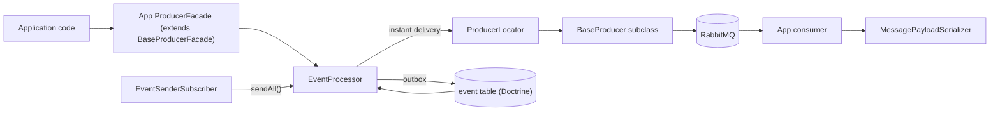
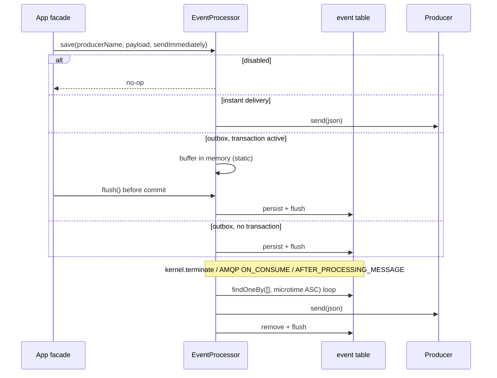

# Architecture

## Overview

Roslov Queue Bundle is a Symfony bundle layered on top of `php-amqplib/rabbitmq-bundle` (`old_sound_rabbit_mq`).
The host application configures RabbitMQ connections, producers, and consumers in the RabbitMQ bundle; this bundle
adds a typed message envelope, payload mapping, an event processor, RPC wiring, and exception events.



## Source layout

```text
src/
├── Attribute/            # AsQueuePayload (type + optional rpcHandler)
├── DependencyInjection/  # Configuration, RoslovQueueExtension, Compiler/PayloadMappingPass
├── Dto/                  # Message envelope + default payloads (Error, Trigger, EmptyResponse, ExceptionThrown)
├── Entity/               # Event (transactional outbox row)
├── Exception/            # Bundle exceptions (base: Exception)
├── Factory/              # PayloadFactory (type <-> class), MessageFactory (envelope)
├── Generator/            # IdGenerator (RPC request IDs)
├── Helper/               # ExceptionShortener
├── Processor/            # EventProcessor
├── Producer/             # BaseProducer, BaseProducerFacade, ProducerLocator, ProducerFacade, ExceptionThrownProducer
├── RabbitMQ/             # SimpleSslContextProvider
├── Repository/           # EventRepository
├── Resources/config/     # services.yaml
├── Rpc/                  # Client, ClientInterface, Server, HandlerInterface
├── Sender/               # ExceptionSender
├── Serializer/           # MessagePayloadSerializer
├── Subscriber/           # EventSenderSubscriber, ExceptionSubscriber
└── RoslovQueueBundle.php # Bundle class
tests/                    # PHPUnit tests mirroring src/, Fixtures/ for dummy DTOs and handlers
```

## Container build lifecycle

```text
RoslovQueueExtension::prepend()
  ├── processes roslov_queue config
  ├── rpc_client.enabled  -> old_sound_rabbit_mq.rpc_clients.roslov_queue
  ├── rpc_server.enabled  -> old_sound_rabbit_mq.rpc_servers.roslov_queue (callback roslov_queue.rpc.server_callback)
  └── always              -> old_sound_rabbit_mq.producers.event_exception_thrown (ExceptionThrownProducer)
RoslovQueueExtension::load()
  ├── loads Resources/config/services.yaml
  ├── replaces constructor arguments of roslov_queue.* services with processed config values
  └── stores explicitly configured payload types in a temporary parameter
RoslovQueueBundle::build()
  ├── registers #[AsQueuePayload] autoconfiguration -> tag roslov_queue.payload {type, class, rpc_handler?}
  └── adds PayloadMappingPass
PayloadMappingPass::process()
  ├── merges defaults + YAML mapping + tagged payloads (YAML wins; duplicate attribute types -> LogicException)
  ├── merges rpc_handler references into roslov_queue.rpc.server_callback handlers
  └── removes the temporary parameter and the roslov_queue.payload tags
```

Service arguments in `services.yaml` are placeholders (for example `false`, `my_service`, `~`); the extension replaces
them by **index**. When changing a constructor signature, update `services.yaml`, the extension, and the related tests
together.

## Public services and aliases

| Alias / interface                                        | Service ID                                           |
|----------------------------------------------------------|------------------------------------------------------|
| `Roslov\QueueBundle\Serializer\MessagePayloadSerializer` | `roslov_queue.serializer.message_payload_serializer` |
| `Roslov\QueueBundle\Processor\EventProcessor`            | `roslov_queue.event_processor`                       |
| `Roslov\QueueBundle\Rpc\ClientInterface`                 | `roslov_queue.rpc.client`                            |
| `Roslov\QueueBundle\Sender\ExceptionSender`              | `roslov_queue.exception_sender`                      |
| `Roslov\QueueBundle\Subscriber\EventSenderSubscriber`    | `roslov_queue.subscriber.event_sender`               |
| (consumer config reference)                              | `roslov_queue.rabbitmq.simple_ssl_context_provider`  |

## Publishing flow



## RPC flow

```text
Client::call(command, exchange, timeout)
  -> serialize command -> RpcClient::addRequest(body, exchange, requestId, '', timeout) -> getReplies()
Server::execute(AMQPMessage)
  -> setup() (optional) -> EntityManager::clear() -> deserialize -> handlers[command::class]->handle()
  -> serialize result (DTO or Error) -> reply
Client
  -> deserialize reply[requestId] -> DTO or Error
```

## Exception event flow

```text
kernel.exception / console.error
  -> ExceptionSubscriber (enabled? validator? HttpException != 500 skipped)
  -> ExceptionSender (service name, hostname, class, file, line, shortened message/trace, shortened REQUEST_URI)
  -> internal ProducerFacade::sendExceptionThrownEvent() (sendImmediately = true)
  -> producer event_exception_thrown -> routing key exception-thrown
```

## Design constraints

- `EventProcessor` keeps buffered events in a **static** array shared across instances in the same process.
- Message bodies stored in the outbox are limited to 4096 characters (`Event::$body`, `varchar(4096)` in the
  documented `event` table schema); producer names are limited to 64 characters.
- The serializer builds a Symfony `Serializer` with `ObjectNormalizer` + `JsonEncoder`; DTOs follow the existing
  convention of private typed properties with public getters/setters.
- The bundle must not depend on application code; tests use dummy fixtures only.
